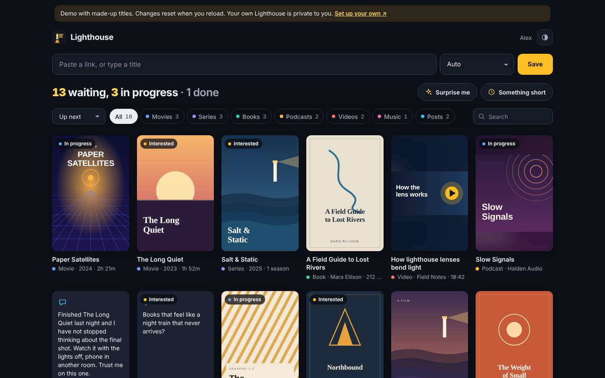
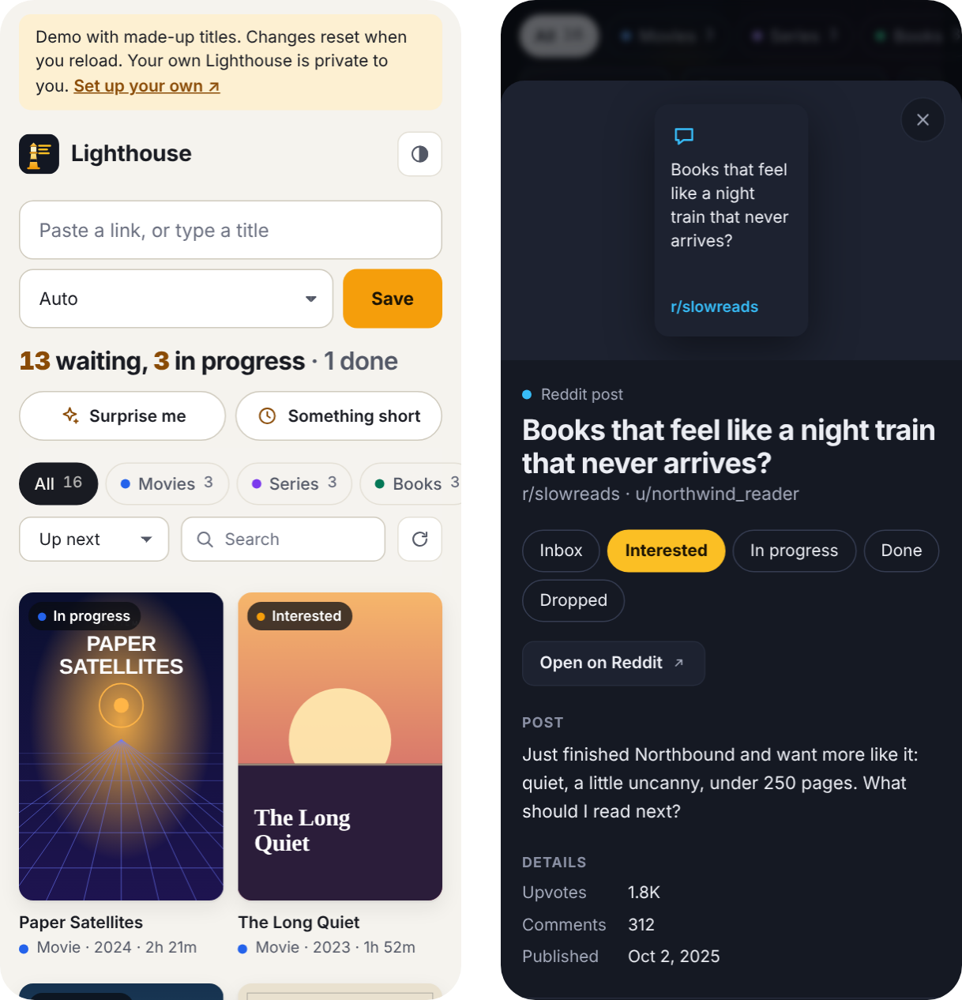
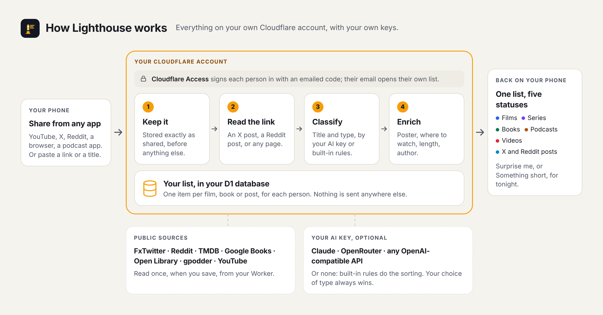

# Lighthouse

[](https://github.com/khubli/lighthouse/actions/workflows/test.yml) [](LICENSE)

**One list for everything you mean to watch, read or listen to, and the posts that told you to.**

Films, series, books, podcasts, YouTube videos, and the X and Reddit posts where people recommended them, in one list on your phone. Share a link from any app or type a title: Lighthouse works out what it is, looks it up, and files it with a poster, where to watch it and how long it takes. On a free evening, it picks something for you.

**[Live demo](https://khubli.github.io/lighthouse/)** (made-up titles) · **[Set it up](docs/setup.md)** in about 15 minutes



## Why Lighthouse

Trackers keep films in one app, books in another and podcasts nowhere, and the post that made you want any of them sits in X bookmarks or Reddit saves, where it is never seen again. Lighthouse puts all of it in one list, on your own account.

- **Everything in one list, the posts included.** Films, series, books, podcasts, videos, music, and X and Reddit posts share one list and the same five statuses. A Reddit thread of book suggestions sits beside the book you picked from it.
- **Links become things.** Share an X post and you get its author, text and image; a Reddit post, its title, subreddit and author; any other page, its title and description. A link that can't be read asks you for a note instead of saving a bare URL.
- **Bring your own AI key, or none.** Claude, any model on OpenRouter (free ones work), or any OpenAI-compatible API including a model on your own machine, chosen by which key you set. With no key, built-in rules do the sorting. Pick the type yourself and your choice always wins.
- **In every app's share sheet.** Installed on Android, Lighthouse sits in the share sheet of YouTube, X, Reddit, your browser and the rest. On an iPhone, which doesn't let web apps receive shares, you paste the link instead.
- **Details from the source.** TMDB for films and series, with where to watch in your country; Google Books, then Open Library, for books; gpodder for podcasts; YouTube for videos. One provider being down costs a field, not the item.
- **"What should I watch tonight?"** **Surprise me** picks one thing, favouring what you've started, what you've marked interesting and what's rated well. **Something short** prefers a film under two hours, a one-season show or a slim book. Ask again and it moves on.
- **Yours, with nothing to shut down.** It runs on your own Cloudflare account on the free plan, with your own keys and your own database. There is no company in the middle to close it, as Mozilla closed Pocket in 2025; nothing goes to the authors, and there is no analytics.
- **Private for a household.** Behind Cloudflare Access, each person signs in with an emailed code and their email opens their own list. Without Access, accounts sign in with a name and PIN.

**What it is not:** a social network, a recommendation engine, or a tracker of what you watched elsewhere. It keeps what you choose to save, and nothing else.

**Who it's for:** anyone who keeps losing recommendations across apps and is happy to spend 15 minutes deploying it to their own free Cloudflare account.

<p align="center"></p>

## How it works

<picture>
  <source media="(prefers-color-scheme: dark)" srcset="docs/images/how-it-works-dark.png">
  
</picture>

Everything runs in one Cloudflare Worker with one D1 database, both on your account. [docs/how-it-works.md](docs/how-it-works.md) has each stage, and what leaves your account.

## How you use it

1. **Save.** Paste a link or type a title into the box, or share from another app. Lighthouse fills in the rest in a few seconds.
2. **Track.** Open anything to move it between **Inbox**, **Interested**, **In progress**, **Done** and **Dropped**, open it on YouTube, X or Reddit, or fix its title or type.
3. **Choose.** Filter by type, search everything, or let **Surprise me** decide.

Light and dark follow your device, or switch with the button at the top.

## Set it up

You need a Cloudflare account and Node.js 22.18 or later. From a terminal:

```sh
git clone https://github.com/khubli/lighthouse.git
cd lighthouse/worker && npm ci && npx wrangler login
cp wrangler.template.toml wrangler.toml
npm run db:create                         # paste the database_id it prints into wrangler.toml
npm run db:migrate:remote
npx wrangler secret put SESSION_SECRET    # any long random string
npm run deploy
npm run users -- add yourname             # asks for a 4-10 digit PIN
```

**[docs/setup.md](docs/setup.md)** walks through each step: installing it on your phone, an AI key, the other optional keys, signing in with Cloudflare Access, your own domain, updating, and what to do if you can't sign in.

## Documentation

- [Set up Lighthouse](docs/setup.md): deploy, your account, your phone, an AI key, Cloudflare Access, your own domain, updating, sign-in problems
- [Configuration](docs/configuration.md): every secret and setting, the commands, the routes, the database
- [How it works](docs/how-it-works.md): capture, reading links, classification, enrichment, picking, the app, what leaves your account
- [Deploy from GitHub](examples/instance/README.md): a private repository that deploys Lighthouse to your account with one button
- [Security](SECURITY.md): the threat model, the controls, reporting a problem

## Commands

From `worker/`, after `npm ci`:

```sh
npm run dev          # the app on http://localhost:8787 with a local database
npm test             # the test suite, offline, about fifteen seconds
npm run demo         # the demo with made-up titles, built into ../_site
npm run verify       # typecheck, tests and the docs check, as CI runs them
npm run users -- list | add <name> | set-pin <name> | link <name> <email>
```

## Responsible use

Lighthouse reads a link once, when you save it, the way a browser would: an X post through FxTwitter's public API, a Reddit post through Reddit's embed endpoint, any other page directly. It doesn't crawl, follow links further, or save anything you didn't share. Saved items are for your own reference.

## Contributing

Bug reports and fixes are welcome: see [CONTRIBUTING.md](CONTRIBUTING.md). Security reports: [SECURITY.md](SECURITY.md). Changes: [CHANGELOG.md](CHANGELOG.md).

## Brand

Icon, colours, type and the share image: [docs/brand](docs/brand/).

## How Lighthouse was built

Krishna Tej Hubli designed and directed Lighthouse: the problem, the requirements and constraints (one list for every kind of recommendation, the posts included; your own free Cloudflare account and your own keys; working with no AI at all; private for a household), and the product and architecture decisions. The code, tests and docs were written by [Claude Code](https://claude.com/claude-code), Anthropic's coding agent, working from that direction. Every change was reviewed before it was merged, and every commit credits Claude as co-author.

## License

[MIT](LICENSE). The app uses your system's fonts and its own icons; there are no third-party assets.
