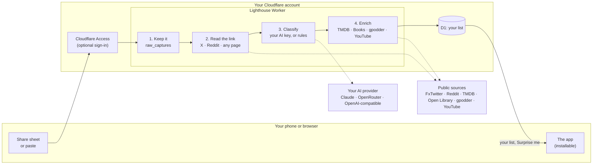

# How Lighthouse works

One Cloudflare Worker and one D1 database, both on your Cloudflare account. The Worker serves the app, signs you in, and runs the pipeline that turns whatever you paste or share into a typed, enriched item.

## 1. Keep it

What you send is stored in `raw_captures` exactly as it arrived, before anything else happens. If classification or every provider fails, the original is still there, and `processed_status` records how far it got (`processed`, or `needs_context` for a post that could not be read).

## 2. Read the link

If the text contains a link, the Worker reads it once so the next step has something to go on:

- **X posts** come from FxTwitter's public API: author, text, image, date and counts. X's own embed endpoint is tried after it, for the text alone.
- **Reddit posts** are read through Reddit's embed endpoint, which answers Cloudflare Workers where its JSON API does not: the title, the author and the subreddit. A share link from the Reddit app (`reddit.com/r/…/s/…`) is resolved from its redirect first. Where Reddit allows the JSON API, the post's text, image, upvotes and comment count come too.
- **Anything else** is read for its Open Graph title, description and site name.

A post that can't be read (deleted, private, or the service down) isn't saved as a bare link with no title: Lighthouse asks for a short note, and saves the link with that.

## 3. Classify

A model reads your words and the link preview and returns a title, a type (movie, series, book, podcast, video, music, post) and why you saved it. It is whichever provider you set a key for (Claude, OpenRouter, or any OpenAI-compatible API), asked the same question in the same words, so switching provider changes the model and nothing else. Claude is asked for low effort and an answer that fits a JSON schema.

Without a key, or if the model is slow, down or declines, built-in rules do the same job less cleverly: a link to an X or Reddit post is a post, "novel" means a book, and so on, with the title taken from your own words or, for a bare link, from the page.

When you pick a type in the app instead of **Auto**, that choice replaces the classifier's on the server. Saved as a post, an X or Reddit link is the post itself; saved as, say, a book, the post was only the context for finding the book. Browsing a type (say, Books) makes it the choice for your next save, so adding a book while looking at books stays a book.

## 4. Enrich

Each type has its own sources, tried in order, so one provider being down costs you a field, not the item:

| Type | First | Then |
|---|---|---|
| Movie, series | TMDB: poster, synopsis, year, rating, runtime or seasons, genres, where to watch in your region | nothing |
| Book | Google Books | Open Library |
| Podcast | gpodder (best-scoring title match) | nothing |
| Video, music | YouTube oEmbed: title, channel, thumbnail | YouTube Data API: duration, views, likes, date |
| Post (X) | FxTwitter | X oEmbed (text only) |
| Post (Reddit) | Reddit's JSON API, where allowed | Reddit oEmbed: title, author, subreddit |
| Not sure | TMDB as a film, then books, then podcasts | |

**Duplicates.** An item is one title of one type for one account. Saving the same film twice updates the existing item. If enrichment renames an item to a title you already have (you saved "dune 2021" and already had "Dune"), the two are merged into one, never across accounts. Posts are the exception: a post is identified by its id, not its title, because two Reddit posts called "Book recommendations?" are different posts. The same post saved twice, by share link or permalink, is still one item.

## Statuses

Every item is in one of five states: **Inbox** (just saved), **Interested**, **In progress**, **Done** and **Dropped**. The app shows "Up next" (the first three) by default; the menu next to the type chips shows the others.

## "What should I watch tonight?"

**Surprise me** and **Something short** pick one unfinished item. Each candidate gets a score:

- **In progress** 6, **Interested** 5, **Inbox** 3, so things you have started or chosen come first;
- plus half its rating;
- for **Something short**, plus 5 for a film of two hours or less, a series with one season, or a book of 250 pages or fewer.

The highest score wins; ties are broken at random, and the item just shown is skipped, so asking again moves on.

## The app

The whole interface is one HTML page with its styles and script inline, generated by [`worker/src/dashboard.ts`](../worker/src/dashboard.ts). There is no framework and no build step for it: the Worker returns a string. That is also its main trap, described in [CONTRIBUTING.md](../CONTRIBUTING.md): the page's script lives inside a TypeScript template literal, so the compiler can't check it. The test suite parses it, checks every element it looks up exists, and runs it against a stand-in DOM.

It installs as an app (a PWA). The service worker caches only icons and the sign-in page, for offline. Your list, and the app page itself, always come from the network, so an installed app never shows yesterday's list as if it were today's. The manifest's share target is what puts Lighthouse in Android's share sheet: a shared link opens the app with the box filled in, and waits through sign-in if needed. Behind Cloudflare Access the manifest is requested with your sign-in, so installing works there too.

## Sign-in

**With Cloudflare Access** (recommended), Access signs each person in with a one-time code by email before any request reaches the Worker, and adds a signed token saying who they are. Lighthouse trusts that token only after checking it: an RS256 signature by one of your team's published keys (cached, and refetched when Access rotates them), your team as the issuer, your application's audience tag, and the expiry. The verified email opens the list it is linked to; there is no PIN to enter.

**Without Access**, an account is a name and a PIN. PINs are stored as PBKDF2-SHA256 with 100,000 rounds (the most Cloudflare Workers allow) and a random salt per account; signing in sets an `HttpOnly`, `Secure`, `SameSite=Lax` cookie, signed with `SESSION_SECRET`, that lasts seven days. A PIN is a weak password, which is why Access is recommended; [SECURITY.md](../SECURITY.md) has the details.

## Privacy: what leaves your Cloudflare account

- **Text you save, and the link preview,** to the AI provider whose key you set, if any (and from OpenRouter, to the model you chose).
- **Titles,** to TMDB, Google Books or Open Library, gpodder, and YouTube, to look them up.
- **Links you save,** read by your Worker: X posts through FxTwitter, Reddit posts through Reddit, other pages directly.
- **Images** in the app load from where the providers host them (TMDB, Google, YouTube, X, Reddit), so those hosts see your device's requests for them.

Nothing goes to the authors of Lighthouse. There is no analytics and no telemetry. Your list lives in your D1 database and nowhere else.

## Limits

- **No sharing into it on iPhone.** iOS doesn't let web apps receive shares, so on an iPhone or iPad you paste links into the box. Android and desktop browsers can share into it.
- **No image understanding.** A screenshot with no text is stored but can't be classified.
- **X and Reddit depend on public endpoints.** FxTwitter is not an official X API, and Reddit's embed endpoint gives only a post's title, author and subreddit. If shared posts start failing, look there first.
- **One region for streaming.** "Where to watch" uses `DEFAULT_REGION` for everyone on the Worker.
- **Book matching is the provider's first hit.** An obscure or ambiguous title can be enriched as a different book. **Rename** and **Refresh details** fix it.
- **Up to 500 items** are shown and considered for a pick, the most recently changed first.
